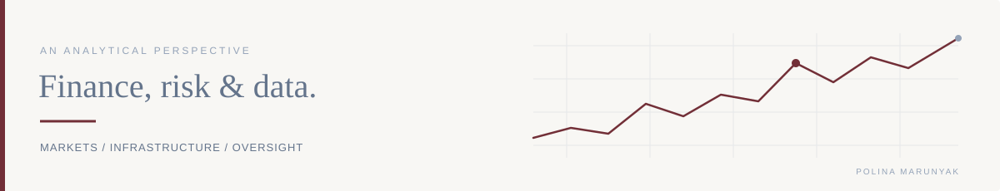

# Polina Marunyak

### International Finance · Risk & Compliance · Data Analytics

MSc International Finance student with experience in regulatory compliance and financial market infrastructure. Currently developing analytical skills in Python and data visualization, with a particular interest in financial markets, risk analytics and market surveillance.

 

## 01 &nbsp; Areas of Interest

| Markets & infrastructure | Risk & oversight |
| :--- | :--- |
| Financial Markets & Market Infrastructure | Risk & Regulatory Compliance |
| Financial Data Analytics | Market Surveillance |

 

## 02 &nbsp; Technical Toolkit

**Used in work or personal projects**

Python · pandas · NumPy · Matplotlib · Seaborn · Excel

Continuing to develop depth in Python-based analysis and data visualization.

**Currently learning**

Power BI · Git & GitHub

 

---

## 03 &nbsp; Selected Projects

FINANCIAL MARKETS &nbsp; / &nbsp; ANOMALY ANALYSIS

### Market Activity Anomaly Monitor

A Python-based financial market analysis project examining unusual price movements and trading volume across **LVMH**, **BNP Paribas** and **Airbus**.

**Built with** &nbsp; Python · pandas · NumPy · Matplotlib · Seaborn

**Repository** &nbsp; *Link to be added when published.*

<!-- Replace the publication note above with the repository link once it is public. -->

---

 

## 04 &nbsp; Contact

[LinkedIn ↗](https://www.linkedin.com/in/polina-mariya-marunyak) &nbsp; · &nbsp; [pmarunyak@gmail.com](mailto:pmarunyak@gmail.com)
