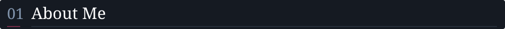
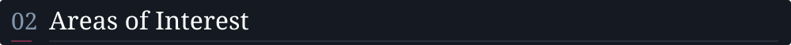
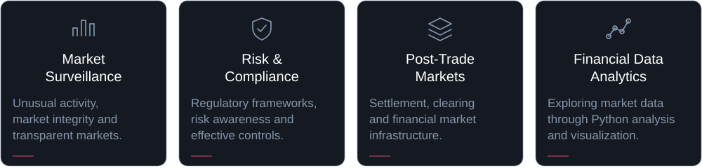
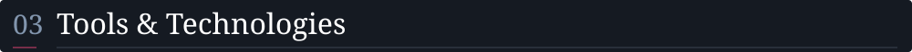
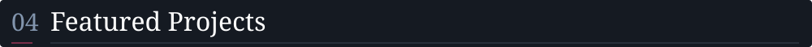
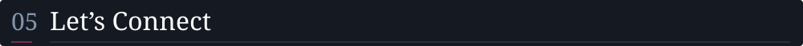

<picture>
  <source media="(max-width: 600px)" srcset="assets/finance-header-mobile.png">
  
</picture>

<h3>
<picture>
  <source media="(max-width: 760px)" srcset="assets/portfolio/section-01-mobile.svg">
  
</picture>
</h3>

MSc International Finance student exploring **financial markets, risk, regulatory compliance and data analytics**. Developing practical Python research skills, with a particular interest in market surveillance and financial market infrastructure.

<h3>
<picture>
  <source media="(max-width: 760px)" srcset="assets/portfolio/section-02-mobile.svg">
  
</picture>
</h3>

<picture>
  <source media="(max-width: 760px)" srcset="assets/portfolio/interests-mobile.svg">
  
</picture>

<h3>
<picture>
  <source media="(max-width: 760px)" srcset="assets/portfolio/section-03-mobile.svg">
  
</picture>
</h3>

  
  
  
  
  
  
  
  
  

Building analytical depth through project work. Currently learning Power BI, Git and GitHub.

<h3>
<picture>
  <source media="(max-width: 760px)" srcset="assets/portfolio/section-04-mobile.svg">
  
</picture>
</h3>

<table>
<tr><td>
<h3>Market Activity Anomaly Monitor</h3>

IN PROGRESS

A Python-based exploratory analysis of historical stock prices and trading volumes for <strong>LVMH, Airbus and BNP Paribas</strong>, screening for unusual market activity using defined statistical criteria.

<strong>Research scope</strong> Data preparation · Daily returns &amp; volume analysis · Rolling volume benchmarks · Statistical screening · Visual interpretation

Python · pandas · NumPy · Matplotlib · Seaborn

<picture>
  <source media="(max-width: 760px)" srcset="assets/portfolio/research-preview-mobile.svg">
  
</picture>

<!-- Replace the preview image above with one or two real Colab exports and descriptive alt text when the files are available. -->
<!-- Add a repository link only after the project repository is published. -->
</td></tr>
</table>

<h3>
<picture>
  <source media="(max-width: 760px)" srcset="assets/portfolio/section-05-mobile.svg">
  
</picture>
</h3>

