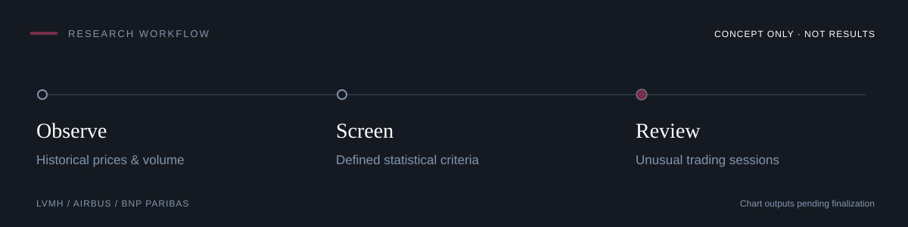

# Polina Marunyak

**MSc International Finance · Regulatory compliance · Financial data analytics**

Experience in regulatory compliance, controls and financial market infrastructure, including **Clearstream (Deutsche Börse Group)**. Developing Python analysis and visualization skills, with a focus on financial markets, risk and market surveillance.

## Selected project

### Market Activity Anomaly Monitor

IN FINALIZATION · PYTHON / FINANCIAL MARKETS

Analyzing historical price movements and trading volumes for **LVMH, Airbus and BNP Paribas** to identify unusual trading sessions using defined statistical criteria.

**Toolkit** &nbsp; Python · pandas · NumPy · Matplotlib · Seaborn 
*Project outputs and a repository link will follow when published.*

---

### Focus

Financial Markets & Market Infrastructure · Market Surveillance 
Risk & Regulatory Compliance · Financial Data Analytics

### Technical toolkit

**Used in work or personal projects** · Python, pandas, NumPy, Matplotlib, Seaborn, Excel. Continuing to build depth in analysis and visualization.

**Learning** · Power BI, Git & GitHub. **Notebook environment** · Google Colab.

---

[LinkedIn ↗](https://www.linkedin.com/in/polina-mariya-marunyak) &nbsp; / &nbsp; [pmarunyak@gmail.com](mailto:pmarunyak@gmail.com)
